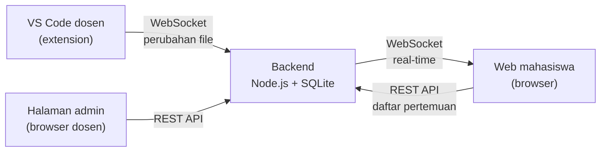

# Live Coding Classroom

Sistem untuk membagikan sesi live coding dosen ke mahasiswa secara real-time, sekaligus menyimpan kode setiap pertemuan supaya bisa dibuka lagi kapan saja.

Dosen cukup mengetik di VS Code seperti biasa. Mahasiswa membuka browser, memasukkan kode akses mata kuliah, lalu melihat file tree dan isi file yang sedang dikerjakan dosen, termasuk file yang sedang dibuka dosen ("Follow Dosen"). Setelah kelas selesai, kode tersimpan sebagai arsip pertemuan yang bisa dibuka read-only.

## Daftar isi

- [Fitur](#fitur)
- [Cara kerja](#cara-kerja)
- [Struktur repository](#struktur-repository)
- [Kebutuhan](#kebutuhan)
- [Menjalankan di komputer lokal](#menjalankan-di-komputer-lokal)
- [Panduan dosen](#panduan-dosen)
- [Panduan mahasiswa](#panduan-mahasiswa)
- [Konfigurasi](#konfigurasi)
- [Keamanan dan privasi](#keamanan-dan-privasi)
- [Deploy ke VPS](#deploy-ke-vps)
- [Backup data](#backup-data)
- [Pengujian](#pengujian)
- [Troubleshooting](#troubleshooting)

## Fitur

**Untuk dosen**
- Live coding langsung dari VS Code: file tree, isi file, dan file yang sedang dibuka terkirim otomatis setiap kali disimpan.
- Blok (seleksi) kode di VS Code ikut tersorot di layar mahasiswa, termasuk multi-cursor.
- Banyak mata kuliah, masing-masing dengan kode akses sendiri yang bisa disalin, dinonaktifkan, atau dibuat ulang.
- Pertemuan per mata kuliah dengan status **Belum dimulai**, **Live**, atau **Selesai**, dan bisa ditampilkan atau disembunyikan dari mahasiswa.
- **Lanjutan project**: pertemuan bisa ditandai sebagai lanjutan pertemuan sebelumnya. Mahasiswa melihat label "Lanjutan dari Pertemuan X" dan badge **Baru**/**Diubah** per file.
- Sembunyikan file atau folder tertentu lewat klik kanan di VS Code (misalnya file kunci jawaban), dan tampilkan lagi kapan saja.
- File sensitif dan folder besar (`.env`, `node_modules`, `vendor`, `build`, `.dart_tool`, keystore, dan lain-lain) tidak pernah dikirim.
- Halaman admin di web untuk mengelola mata kuliah, kode akses, dan pertemuan.

**Untuk mahasiswa**
- Masuk dengan nama dan kode akses, tanpa membuat akun.
- Hanya melihat mata kuliah yang kodenya dimiliki.
- Viewer kode read-only (Monaco Editor, sama seperti VS Code) dengan syntax highlighting.
- Mode Follow Dosen: viewer otomatis membuka file yang sedang dibuka dosen dan scroll ke bagian yang sedang disorot dosen.
- Arsip setiap pertemuan tetap bisa dibuka setelah kelas selesai.
- Tersambung ulang otomatis bila koneksi terputus.

## Cara kerja



1. Extension VS Code membaca folder project, menyaring file yang dikecualikan, lalu mengirim file tree dan isi file ke backend lewat WebSocket. Setiap file yang disimpan dikirim ulang.
2. Backend menyimpan kode ke database SQLite per pertemuan dan meneruskannya ke mahasiswa yang sedang membuka pertemuan itu.
3. Web mahasiswa menampilkan file tree dan isi file. Untuk pertemuan yang sudah selesai, isinya diambil dari database.

**Struktur data**

```
Mata kuliah (nama, kode akses)
└── Pertemuan (nomor, judul, status, tampil/sembunyi, lanjutan dari pertemuan lain)
    └── File (path, isi)
```

File yang isinya sama di beberapa pertemuan hanya disimpan sekali, jadi pertemuan lanjutan hampir tidak menambah ukuran database.

## Struktur repository

```
livecoding/
├── live-coding-backend/      Backend Node.js: REST API, WebSocket, database SQLite
├── live-coding-frontend/     Web React + Vite: halaman mahasiswa dan admin dosen
└── live-coding-classroom/    Extension VS Code untuk dosen
```

Setiap folder punya README sendiri dengan detail teknis:
[backend](live-coding-backend/README.md) (daftar endpoint dan event WebSocket),
[frontend](live-coding-frontend/README.md),
[extension](live-coding-classroom/README.md).

## Kebutuhan

| Komponen | Versi |
|---|---|
| Node.js | **22.13 atau lebih baru** (backend memakai `node:sqlite` bawaan Node) |
| VS Code | 1.90 atau lebih baru |
| Browser mahasiswa | Chrome, Edge, Firefox, atau Safari versi terbaru |

Viewer kode memuat Monaco Editor dari CDN (`cdn.jsdelivr.net`), jadi perangkat mahasiswa perlu akses internet.

## Menjalankan di komputer lokal

### 1. Backend

```bash
cd live-coding-backend
npm install
cp .env.example .env
npm run dev
```

Backend berjalan di `http://localhost:3000`. Database dibuat otomatis di `live-coding-backend/data/livecoding.db`.

### 2. Frontend

```bash
cd live-coding-frontend
npm install
cp .env.example .env
npm run dev
```

Buka `http://localhost:5174`. Halaman admin ada di `http://localhost:5174/admin`.

### 3. Extension VS Code

```bash
cd live-coding-classroom
npm install
npm run compile
npx vsce package --allow-missing-repository --skip-license
code --install-extension live-coding-classroom-0.3.0.vsix
```

Setelah install, jalankan **Developer: Reload Window** di VS Code.

Pastikan `liveCoding.teacherToken` di settings VS Code sama dengan `TEACHER_TOKEN` di `live-coding-backend/.env`. Nilai bawaan keduanya `dev-secret-token` untuk development.

### Urutan menjalankan

Backend dulu, lalu frontend. Extension bisa dipakai kapan saja setelah backend berjalan.

## Panduan dosen

### Persiapan awal semester

1. Buka halaman admin (`/admin`) dan masuk dengan teacher token.
2. Tambahkan mata kuliah. Setiap mata kuliah otomatis mendapat kode akses, misalnya `PM-7K3XQ2`.
3. Bagikan kode akses ke kelas yang sesuai.

Mata kuliah dan pertemuan juga bisa dibuat langsung dari VS Code saat memulai sesi, jadi langkah ini opsional.

### Saat mengajar

1. Buka folder project di VS Code.
2. Jalankan **Live Coding: Start Session** dari Command Palette (`Cmd+Shift+P` / `Ctrl+Shift+P`).
3. Pilih mata kuliah, lalu pilih pertemuan atau buat pertemuan baru.
4. Kalau sudah ada pertemuan sebelumnya, pilih **Lanjutan dari Pertemuan X** bila melanjutkan project yang sama, atau **Project baru**. Pertemuan dengan nama project yang sama ditaruh paling atas.
5. Notifikasi menampilkan kode akses dan link mahasiswa. Indikator **Live** di status bar bisa diklik untuk menyalin link, menyalin kode, atau menghentikan sesi.
6. Mengajar seperti biasa. Setiap kali file disimpan, mahasiswa melihat perubahannya. Blok kode yang ingin dijelaskan, dan bagian itu ikut tersorot kuning di layar mahasiswa. Sorotan mengikuti posisi di file versi tersimpan, jadi simpan dulu bila ada perubahan yang menggeser baris.
7. Selesai kelas, jalankan **Live Coding: Stop Session**. Status pertemuan berubah jadi Selesai dan kodenya tersimpan.

Memilih pertemuan yang sudah selesai akan mengganti isinya dengan kondisi project sekarang (ada konfirmasi sebelumnya).

### Menyembunyikan file

Klik kanan file atau folder di Explorer atau di tab editor, lalu pilih **Sembunyikan dari mahasiswa**. File yang disembunyikan diberi tanda `⊘`. Pilih **Tampilkan ke mahasiswa** untuk membukanya lagi.

- Daftarnya tersimpan di `.livecodingignore` di root project (format seperti `.gitignore`) dan berlaku di semua pertemuan berikutnya.
- Saat live, file langsung hilang dari layar mahasiswa dan dihapus dari server. Cocok untuk menyimpan file jawaban lalu membukanya di akhir kelas.

### Mengelola pertemuan di halaman admin

| Aksi | Efek bagi mahasiswa |
|---|---|
| Sembunyikan pertemuan | Hilang dari daftar. Mahasiswa yang sedang membukanya langsung dikeluarkan. |
| Tampilkan lagi | Muncul kembali di daftar. |
| Ubah judul | Judul baru langsung terlihat. |
| Hapus pertemuan | Hilang permanen beserta kodenya. Pertemuan yang sedang live tidak bisa dihapus. |
| Nonaktifkan kode akses | Mahasiswa tidak bisa masuk ke mata kuliah itu sampai kode diaktifkan lagi. |
| Buat kode baru | Kode lama langsung tidak berlaku. Mahasiswa diminta memasukkan kode baru. |

## Panduan mahasiswa

1. Buka alamat web yang diberikan dosen.
2. Isi nama lengkap dan kode akses mata kuliah, lalu klik **Masuk**.
3. Pilih pertemuan. Pertemuan berlabel **Live** sedang berlangsung, sedangkan **Selesai** adalah arsip.
4. Klik file di panel kiri untuk melihat isinya. Saat live, centang **Follow Dosen** agar viewer mengikuti file yang dibuka dosen.
5. Pada pertemuan lanjutan, file berlabel **Baru** atau **Diubah** menunjukkan apa yang dikerjakan di pertemuan itu.

Kode akses tersimpan di browser, jadi kunjungan berikutnya tidak perlu memasukkan kode lagi.

## Konfigurasi

### Backend (`live-coding-backend/.env`)

| Variabel | Default | Keterangan |
|---|---|---|
| `PORT` | `3000` | Port HTTP dan WebSocket |
| `TEACHER_TOKEN` | `change-this-secret-token` | Token dosen untuk halaman admin dan extension |
| `PUBLIC_BASE_URL` | `http://localhost:5174` | Alamat web mahasiswa, dipakai untuk membuat link pertemuan |
| `MAX_FILE_SIZE_BYTES` | `524288` | Ukuran maksimal satu file teks (512 KB) |
| `WS_HEARTBEAT_MS` | `30000` | Jeda ping WebSocket untuk mendeteksi koneksi yang mati diam-diam |
| `TEACHER_GRACE_MS` | `120000` | Masa tenggang sebelum sesi dinyatakan selesai saat koneksi dosen putus |
| `DB_PATH` | `data/livecoding.db` | Lokasi file database |

### Frontend (`live-coding-frontend/.env`)

| Variabel | Default | Keterangan |
|---|---|---|
| `VITE_WS_URL` | `ws://localhost:3000` | Alamat WebSocket backend |
| `VITE_API_URL` | diturunkan dari `VITE_WS_URL` | Alamat REST API, hanya perlu diisi bila berbeda |

Variabel `VITE_*` dibaca saat build, jadi build ulang setelah mengubahnya.

### Extension VS Code (Settings → Live Coding Classroom)

| Setting | Default | Keterangan |
|---|---|---|
| `liveCoding.backendUrl` | `ws://localhost:3000` | Alamat WebSocket backend |
| `liveCoding.teacherToken` | `dev-secret-token` | Harus sama dengan `TEACHER_TOKEN` |
| `liveCoding.exclude` | `[]` | Pola tambahan yang tidak dibagikan, format `.gitignore` |
| `liveCoding.maxFileSizeKb` | `512` | Ukuran maksimal file teks yang dikirim |

Daftar yang **selalu** dikecualikan: `.git`, `node_modules`, `vendor`, `dist`, `build`, `out`, `coverage`, `.next`, `.nuxt`, `.dart_tool`, `.flutter-plugins*`, `.gradle`, `ios/Pods`, `ios/.symlinks`, `storage/logs`, `storage/framework`, `bootstrap/cache`, `public/build`, `.idea`, `.vscode`, `.env` dan `.env.*` (kecuali `.env.example`), `*.keystore`, `*.jks`, `key.properties`, `*.pem`, `*.log`, `*.sqlite`, `*.sqlite3`, dan file arsip. Gambar dan media hanya tampil namanya tanpa isi.

## Keamanan dan privasi

### Teacher token
Token ini adalah satu-satunya kunci untuk halaman admin dan untuk memulai sesi live. Nilai bawaan (`dev-secret-token`, `change-this-secret-token`) tertulis di kode sumber dan hanya untuk development.

**Sebelum deploy ke server publik**, buat token baru yang panjang dan acak, lalu pasang di `.env` backend dan di setting VS Code:

```bash
node -e "console.log(require('crypto').randomBytes(32).toString('hex'))"
```

### Jangan commit `.env`
File `.env` dan `node_modules` sudah tercantum di `.gitignore`. Bila sebelumnya terlanjur ter-commit, keluarkan dari tracking (file di komputer tidak terhapus) lalu ganti token yang ada di dalamnya:

```bash
git rm -r --cached --ignore-unmatch \
  live-coding-backend/.env live-coding-frontend/.env \
  live-coding-backend/node_modules live-coding-frontend/node_modules live-coding-classroom/node_modules
git commit -m "Stop tracking .env and node_modules"
```

### Kode akses
Kode akses membatasi mahasiswa ke mata kuliahnya sendiri. Bila kode tersebar ke luar kelas, buat kode baru dari halaman admin.

### Perlindungan dari screenshot
Viewer mahasiswa:
- menyembunyikan kode saat shortcut screenshot terdeteksi (PrintScreen, Cmd+Shift, Win+Shift) sampai mahasiswa menekan "Tampilkan lagi",
- memblokir copy, cut, klik kanan, seleksi teks, dan print.

**Batasannya:** browser tidak bisa mencegah screenshot sepenuhnya. Foto dari kamera HP, screenshot lewat menu sistem operasi, dan DevTools tetap bisa dipakai. Tidak ada penanda identitas di atas kode, jadi screenshot yang tersebar tidak bisa dilacak ke mahasiswa asalnya.

### Siapa yang menonton
Saat sesi berjalan, dosen melihat daftar mahasiswa yang sedang membuka pertemuan beserta file yang mereka baca — di panel **Live Coding** pada Activity Bar VS Code, dan di kartu "Menonton sekarang" halaman admin. Tombol orang di tiap baris tabel pertemuan membuka daftar semua mahasiswa yang pernah masuk ke pertemuan itu, termasuk yang sudah selesai.

Nama diketik sendiri mahasiswa tanpa akun, jadi daftar ini laporan kehadiran — bukan bukti identitas.

### Saat koneksi dosen putus
Sesi tidak langsung berakhir. Pertemuan ditahan tetap live selama `TEACHER_GRACE_MS` (bawaan 2 menit) dan mahasiswa melihat "Menunggu dosen tersambung lagi"; kode terakhir tetap terbaca. Kalau dosen kembali dalam tenggang itu, sesi yang sama dilanjutkan — jam sesi tidak mengulang dan file tidak hilang. Lewat dari itu, pertemuan dinyatakan selesai.

Menghentikan sesi dari VS Code mengakhiri pertemuan seketika tanpa tenggang.

### Data yang dikirim
Extension hanya mengirim file di dalam folder project yang tidak dikecualikan. File yang disembunyikan atau dikecualikan tidak pernah meninggalkan komputer dosen.

## Pemeriksaan sebelum push

Jalankan ini sebelum push; keluar dengan kode 1 kalau ada yang gagal.

```bash
./scripts/check.sh
```

| Bagian | Yang diperiksa |
|---|---|
| Lockfile | `package.json` dan `package-lock.json` sinkron di ketiga folder |
| Frontend | `npm run lint` · `npm run build` |
| Backend | smoke test 35 pengecekan |
| Extension | `npm run compile` |

Backend diuji di port 3999 dengan database sementara, jadi server dev dan `data/livecoding.db` tidak tersentuh.

Semuanya butuh Node 22 ke atas — backend memakai `node:sqlite` bawaan Node, dan batas itu ditulis di `engines` tiap `package.json`.

### GitHub Actions (nonaktif)

`.github/workflows/ci.yml` berisi workflow yang menjalankan ketiga pemeriksaan di atas secara otomatis, tapi **pemicunya sedang dimatikan**: akun GitHub terkunci karena masalah penagihan, sehingga runner tidak pernah menyala dan setiap commit akan ditandai merah.

Menghidupkannya setelah penagihan beres: hapus tanda komentar pada dua baris `push:` dan `pull_request:` di berkas itu. Deploy Coolify tidak terpengaruh — ia memakai webhook sendiri, terpisah dari Actions.

## Deploy dengan Docker (Coolify)

### Alur kerja

Coolify memantau `main` dan deploy setiap ada yang masuk. Supaya yang masuk selalu sudah diperiksa, `main` dilindungi dan perubahan masuk lewat pull request.

```
git switch -c fitur-x        kerjakan di branch sendiri
git push -u origin fitur-x
      |
      v
buka Pull Request ke main    CI jalan di PR
      |
      |  merge diblokir sampai ketiga job hijau
      v
merge ke main                <- ini sekaligus keputusan deploy
      |
      v
Coolify build & deploy ke live.devrisetiaf.cloud
```

Karena merge berarti deploy, PR yang sudah hijau bisa dibiarkan menunggu — tidak perlu di-merge di tengah jam kuliah.

**Sekali saja di GitHub** (Settings → Branches → Add branch ruleset untuk `main`):

- *Require a pull request before merging*
- *Require status checks to pass* → pilih `Frontend (lint + build)`, `Backend (smoke test)`, `Extension (compile + package)`

Nama job baru muncul di daftar setelah CI pernah jalan sekali.

Repo menyediakan setup production berbasis Docker:

| File | Fungsi |
|---|---|
| `docker-compose.yml` | Service `backend` (Node.js, port internal 3000) dan `frontend` (Nginx static, port internal 80), named volume `livecoding-data` untuk SQLite |
| `live-coding-backend/Dockerfile` | Image backend Node 22 Alpine, berjalan sebagai user non-root, healthcheck ke `/health` |
| `live-coding-frontend/Dockerfile` | Build Vite lalu disajikan Nginx, dengan fallback SPA |
| `.env.production.example` | Template environment production |

Compose tidak mempublish port ke host; routing domain dan HTTPS diurus Coolify:

| Domain | Service | Port internal |
|---|---|---|
| `https://live.devrisetiaf.cloud` | `frontend` | 80 |
| `https://api-live.devrisetiaf.cloud` | `backend` | 3000 |

Environment yang wajib diisi (lihat komentar di `.env.production.example`):

| Variabel | Jenis | Contoh |
|---|---|---|
| `TEACHER_TOKEN` | runtime, rahasia | hasil `node -e "console.log(require('crypto').randomBytes(32).toString('hex'))"` |
| `PUBLIC_BASE_URL` | runtime | `https://live.devrisetiaf.cloud` |
| `MAX_FILE_SIZE_BYTES` | runtime, opsional | `524288` |
| `WS_HEARTBEAT_MS` | runtime, opsional | `30000` |
| `TEACHER_GRACE_MS` | runtime, opsional | `120000` |
| `VITE_WS_URL` | build-time | `wss://api-live.devrisetiaf.cloud` |
| `VITE_API_URL` | build-time | `https://api-live.devrisetiaf.cloud` |

Variabel `VITE_*` ditanam saat build; mengubahnya membutuhkan rebuild frontend. Kalau `VITE_WS_URL` kosong, build image frontend sengaja **gagal** — tanpa penjaga itu `src/config.js` diam-diam jatuh ke `ws://localhost:3000`, menghasilkan container sehat yang tidak pernah bisa dipakai mahasiswa. Database tersimpan di `/app/data/livecoding.db` dalam volume `livecoding-data` dan tetap ada saat container di-restart atau di-deploy ulang.

Menjalankan stack production secara lokal:

```bash
cp .env.production.example .env.production   # isi nilainya, jangan di-commit
docker compose --env-file .env.production up -d --build
```

Setelah deploy, arahkan VS Code dosen ke `wss://api-live.devrisetiaf.cloud` dengan token yang sama (lihat [langkah 7](#7-arahkan-vs-code-ke-server)).

## Deploy ke VPS (manual, tanpa Docker)

Alternatif tanpa Docker. Contoh berikut memakai Ubuntu 22.04, nginx, dan PM2, dengan dua subdomain:
- `api.domainkamu.com` untuk backend
- `live.domainkamu.com` untuk web mahasiswa dan admin

Ganti dengan domain milikmu, dan arahkan kedua subdomain ke IP VPS (DNS record A).

### 1. Siapkan server

```bash
curl -fsSL https://deb.nodesource.com/setup_22.x | sudo bash -
sudo apt install -y nodejs nginx git sqlite3
sudo npm install -g pm2
```

### 2. Backend

```bash
sudo mkdir -p /var/www && cd /var/www
sudo git clone https://github.com/IndraAlFauzan/livecodingsession.git livecoding
sudo chown -R $USER /var/www/livecoding
cd /var/www/livecoding/live-coding-backend
npm install --omit=dev
cp .env.example .env
nano .env
```

Isi `.env`:

```env
PORT=3000
TEACHER_TOKEN=<token-acak-yang-panjang>
PUBLIC_BASE_URL=https://live.domainkamu.com
MAX_FILE_SIZE_BYTES=524288
```

Jalankan permanen dengan PM2:

```bash
pm2 start src/index.js --name live-coding-backend
pm2 save
pm2 startup   # jalankan perintah yang ditampilkan agar otomatis menyala setelah reboot
```

### 3. Frontend

```bash
cd /var/www/livecoding/live-coding-frontend
echo "VITE_WS_URL=wss://api.domainkamu.com" > .env
npm install
npm run build
```

Hasil build ada di folder `dist/`.

### 4. nginx

Buat `/etc/nginx/sites-available/livecoding`:

```nginx
# Backend: REST API + WebSocket
server {
    server_name api.domainkamu.com;

    location / {
        proxy_pass http://127.0.0.1:3000;
        proxy_http_version 1.1;
        proxy_set_header Upgrade $http_upgrade;
        proxy_set_header Connection "upgrade";
        proxy_set_header Host $host;
        proxy_read_timeout 3600s;
        client_max_body_size 10m;
    }
}

# Web mahasiswa dan admin
server {
    server_name live.domainkamu.com;
    root /var/www/livecoding/live-coding-frontend/dist;
    index index.html;

    location / {
        try_files $uri /index.html;
    }
}
```

Aktifkan:

```bash
sudo ln -s /etc/nginx/sites-available/livecoding /etc/nginx/sites-enabled/
sudo nginx -t && sudo systemctl reload nginx
```

`proxy_read_timeout` yang panjang menjaga koneksi WebSocket tetap hidup selama kelas berlangsung.

### 5. HTTPS

WebSocket aman (`wss://`) membutuhkan HTTPS:

```bash
sudo apt install -y certbot python3-certbot-nginx
sudo certbot --nginx -d api.domainkamu.com -d live.domainkamu.com
```

Certbot mengubah konfigurasi nginx dan memperpanjang sertifikat otomatis.

### 6. Firewall

Cukup buka SSH, HTTP, dan HTTPS. Port 3000 tidak perlu dibuka karena backend diakses lewat nginx.

```bash
sudo ufw allow OpenSSH
sudo ufw allow 'Nginx Full'
sudo ufw enable
```

### 7. Arahkan VS Code ke server

Di settings VS Code dosen:

```json
"liveCoding.backendUrl": "wss://api.domainkamu.com",
"liveCoding.teacherToken": "<token-yang-sama-dengan-di-server>"
```

Halaman admin sekarang ada di `https://live.domainkamu.com/admin`, dan mahasiswa membuka `https://live.domainkamu.com`.

### Update aplikasi

```bash
cd /var/www/livecoding
git pull
cd live-coding-backend && npm install --omit=dev && pm2 restart live-coding-backend
cd ../live-coding-frontend && npm install && npm run build
```

Restart backend saat ada sesi live akan memutus dosen. Pertemuan tersebut otomatis ditandai Selesai dan dosen bisa memulai sesi lagi.

## Backup data

Seluruh data ada di satu file SQLite (default `live-coding-backend/data/livecoding.db`). Untuk backup yang aman meski backend sedang berjalan:

```bash
node scripts/backup.js                 # hasilnya di backups/
```

Skrip itu memakai `VACUUM INTO` dan tidak butuh perkakas tambahan di server — Node sudah ada karena backend memakainya. Cara lain, kalau CLI `sqlite3` terpasang:

```bash
sqlite3 live-coding-backend/data/livecoding.db ".backup 'backup-$(date +%F).db'"
```

Keduanya aman. Yang **tidak** aman adalah `cp livecoding.db`: database memakai mode WAL, jadi perubahan terbaru bisa masih di berkas `-wal` dan tidak ikut tersalin. Diuji pada database yang sedang dipakai, salinan `cp` kehilangan satu tabel penuh dan mata kuliah yang baru dibuat.

Untuk memulihkan, hentikan backend, ganti file database dengan file backup, lalu jalankan lagi.

Contoh backup harian lewat cron (`crontab -e`):

```
0 2 * * * cd /var/www/livecoding && /usr/bin/node scripts/backup.js /var/backups
```

## Pengujian

Uji alur backend secara menyeluruh (dengan backend berjalan):

```bash
cd live-coding-backend
TEACHER_TOKEN=<token> node examples/smoke-test.js
```

Skrip membuat mata kuliah dan pertemuan uji, mencoba alur dosen dan mahasiswa (live, lanjutan, sembunyikan, kode akses), lalu menghapus data ujinya kembali.

## Troubleshooting

| Masalah | Penyebab dan solusi |
|---|---|
| `localhost:5174` menampilkan aplikasi lain, atau `npm run dev` pindah ke port lain | Port sudah dipakai aplikasi lain (misalnya container Docker). Hentikan aplikasi itu, atau ubah `server.port` di `live-coding-frontend/vite.config.js` dan `PUBLIC_BASE_URL` di backend. |
| `Cannot find module @rollup/rollup-darwin-arm64` saat menjalankan frontend | Bug npm pada dependency opsional. Hapus `node_modules` dan `package-lock.json`, lalu `npm install` lagi. |
| Extension: "Teacher token salah" | `liveCoding.teacherToken` di VS Code berbeda dengan `TEACHER_TOKEN` di backend. Samakan, lalu coba lagi. |
| Extension: "tidak bisa terhubung ke backend" | Backend belum berjalan, atau `liveCoding.backendUrl` salah. Di server publik gunakan `wss://`. |
| Backend gagal start dengan error `node:sqlite` | Versi Node terlalu lama. Pakai Node 22.13 atau lebih baru (`node -v`). |
| Mahasiswa: "Kode akses tidak valid" | Kode salah ketik, sudah dibuat ulang, atau dinonaktifkan. Cek kode terbaru di halaman admin. |
| Pertemuan tidak muncul di daftar mahasiswa | Pertemuan belum pernah dimulai dari VS Code (status Belum dimulai), atau sedang disembunyikan. |
| Viewer kode hanya menampilkan "Loading..." | Monaco Editor dimuat dari CDN. Pastikan perangkat mahasiswa terhubung ke internet. |
| Koneksi WebSocket gagal di server, padahal halaman web terbuka | Konfigurasi nginx untuk backend belum memuat header `Upgrade` dan `Connection "upgrade"`. |
| File tidak muncul di sisi mahasiswa | File dikecualikan (daftar bawaan, `liveCoding.exclude`, atau `.livecodingignore`), lebih besar dari `maxFileSizeKb`, atau belum disimpan. File yang disembunyikan bertanda `⊘` di Explorer. |
| Menu klik kanan "Tampilkan ke mahasiswa" tidak muncul | Jalankan **Live Coding: Tampilkan ke mahasiswa** dari Command Palette sambil membuka file tersebut. |
